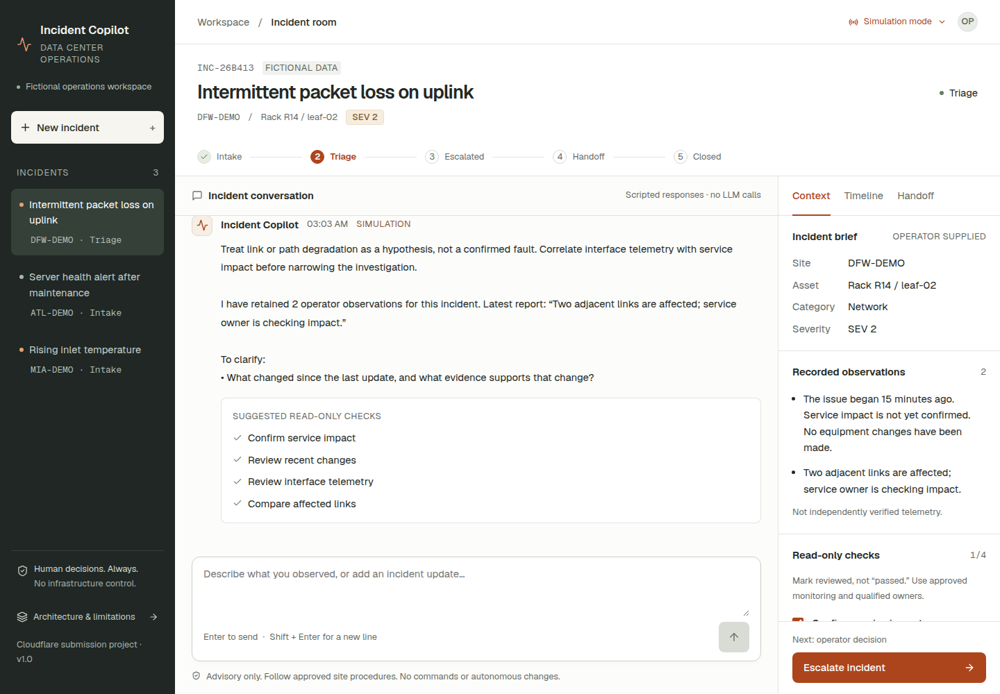
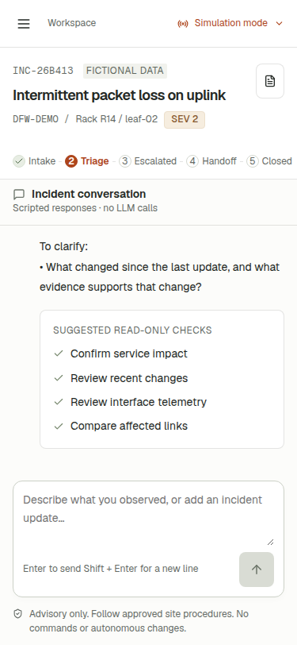

# QA inventory and verification

## Intended experience

Desktop: the initial view shows the selected incident, workflow phase, conversation, composer, context, and operator-only action. At narrow widths, incident selection becomes a drawer and context becomes an explicit toggle. Short desktop windows may scroll rather than clipping primary controls.

## Functional checklist

- Create an incident with title, site, asset, category, and operator-selected severity.
- Switch incidents and verify separate conversation/context.
- Submit chat using the button and Enter; Shift+Enter inserts a newline.
- Confirm mode and provenance labels are visible; simulation is never labeled live AI.
- Record two observations; reload and confirm history is retained.
- Mark a check reviewed, then not reviewed; verify persistence and timeline.
- Prevent triage without an observation.
- Confirm each human phase change with an operator note.
- View Timeline and Handoff; copy or manually select handoff if clipboard is blocked.
- Close an incident and verify chat/checks become read-only.
- Open architecture/limitations and follow the documentation link.
- Close dialogs with the close button and Escape.
- On mobile: open/close incident navigation, context, tabs, and creation dialog.
- Off-happy-path: physical hazard, instruction to change infrastructure, invalid/oversized API requests, workspace isolation, repeated request IDs, inference failure semantics.

## Visual checklist

- Desktop initial and populated conversation at 1440×1000.
- Mobile initial and populated views at 375×812.
- Same browser desktop → mobile → desktop.
- Short desktop at 1440×650.
- No horizontal page overflow, clipped composer, overlapping dialogs, or hidden action controls.
- Focus treatment, labels, state semantics, readable secondary text and contrast.

## Status

Code and local verification are complete, and the source is public on [GitHub](https://github.com/nidusprod/cf_ai_dc_incident_copilot). A successful mock or simulation test does not establish live inference quality, and the project has not yet been deployed into an applicant-owned Cloudflare account.

### Passed

| Check | Result |
|---|---|
| TypeScript strict check | Passed |
| Unit tests | 37 passed across two test files |
| Live inference adapter contract, with mocked provider binding | 13 of the 37 unit tests; model ID, messages/memory, JSON text/object variants, invalid output, provider failure, and prose guard |
| Real Workers AI, REST transport through actual app adapter | One accepted response after a response-format fix; three live calls total including diagnosis; see LIVE_VALIDATION.md |
| Local real Worker + Durable Object HTTP integration | 22 checks passed |
| Vite production and preview builds | Passed |
| Wrangler production-config deployment dry-run | Passed; no account deployment or inference performed |
| npm dependency audit | 0 reported vulnerabilities in the final dependency tree at verification time |
| Hosted proxy, normal browser document | Chat button / Enter, refresh memory, reviewed checks, operator phase change, context, timeline, and handoff passed |
| Hosted proxy, opaque sandbox iframe | Capability initialization, API access, chat button / Enter, create incident, safety response, reviewed check, phase change, and handoff passed |
| Desktop | 1440×1000 initial/populated conversation and context inspected |
| Mobile | 375×812; incident drawer, close control, context toggle, tabs, composer, and desktop → mobile → desktop cycle checked |
| Short desktop | 1440×650; controlled vertical page scrolling, no horizontal overflow, send/action controls reachable |
| Interrupted response / replay | Committed chat response deliberately dropped; input preserved; retry reused the same ID and persisted exactly one new observation |
| Restricted clipboard | Browser denied clipboard permission as expected; visible manual-copy explanation and selectable handoff text verified |
| Runtime page exceptions | None observed during the final hosted checks |

The clipboard permission warning in the restricted iframe and a failed-request browser message in the deliberate response-loss test were expected test conditions, not hidden successful-path failures. Buttons invoke validated application handlers directly, so core flows do not require a sandbox's `allow-forms` permission.

The dependency tree pins a patched `undici` version through an npm override because the selected Wrangler/Miniflare tree otherwise selected an audited vulnerable version. Audit results are a point-in-time check, not a security certification.

### Representative screenshots

Both screenshots show explicitly labeled simulation responses. They are evidence of UI and workflow behavior, not live model output.

### Still not verified

- Native Workers AI binding inside a deployed Worker and production deployment/plan eligibility. REST inference through the actual adapter is now verified, as documented separately.
- Remote Durable Object persistence across real Cloudflare deployments.
- Real Cloudflare Access / identity controls, which are not implemented in this prototype.
